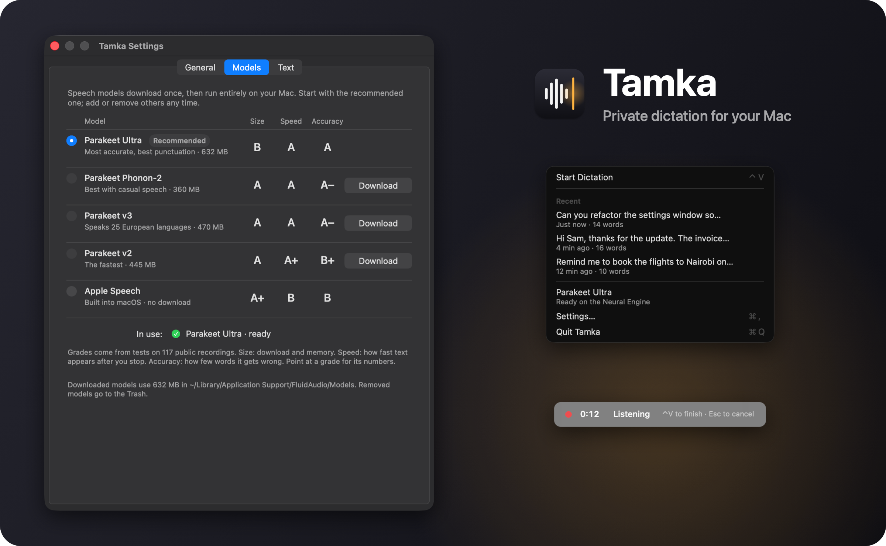
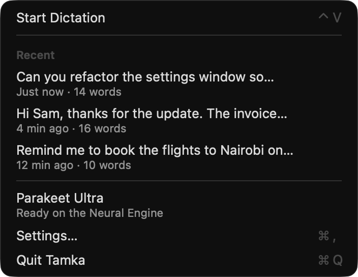
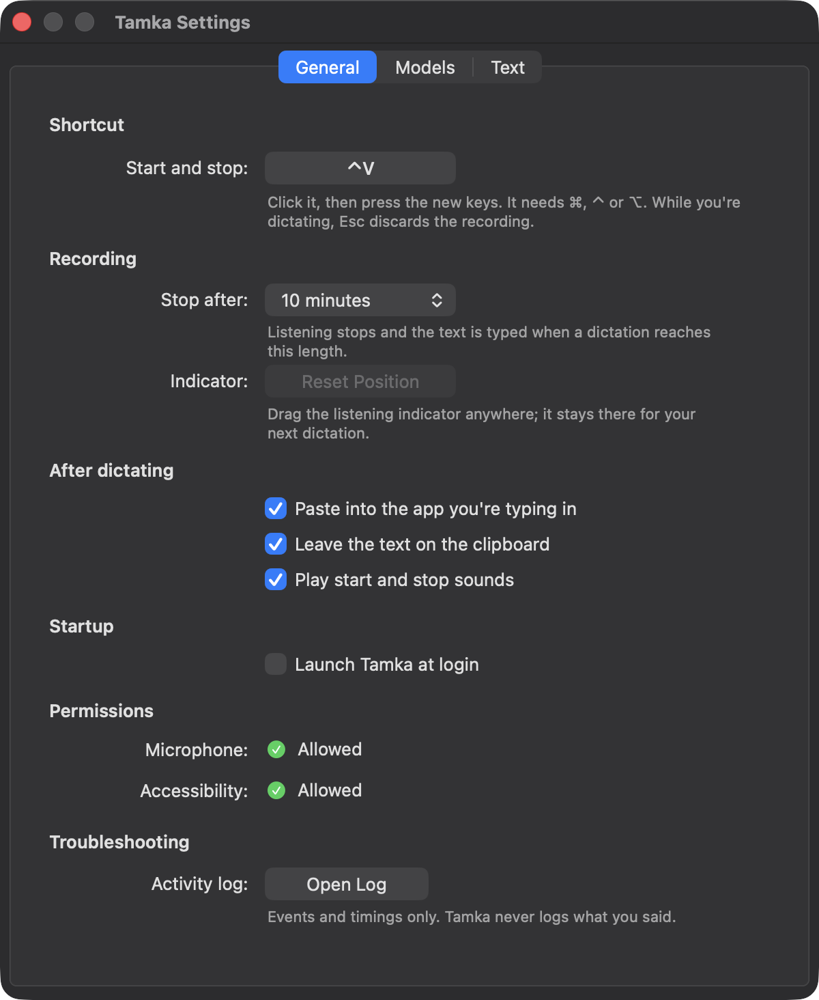

<h1 align="center">
  <br>
  Tamka
</h1>

<p align="center">
  <strong>Talk instead of type.</strong><br>
  Press a shortcut, say what you mean, and clean text appears wherever your cursor is.<br>
  Everything happens on your Mac.
</p>

<p align="center">
  
  
  
  
</p>

<p align="center">
  
</p>

<p align="center"><sub><em>Tamka</em> (TAHM-kah) is Swahili for "to pronounce, to utter".</sub></p>

---

## At a glance

| | |
|---|---|
| 🔒 **Private.** Your voice is turned into text by the Neural Engine inside your Mac. No account, no cloud, no subscription. | ⚡ **Quick.** Text lands about 0.2 seconds after you stop talking, even after 50 seconds of speech. |
| ✨ **Clean.** "Um" and "uh" vanish, stutters collapse, and saying "comma" or "new line" types the real thing. | 🪶 **Light.** About 80 MB for the app and its engine, plus the model you pick. No CPU use between dictations. |
| 🖐 **Out of your way.** Drag the listening indicator anywhere. It stays there for next time. | 🎚 **Your model.** Download the speech model you want, guided by plain letter grades. Remove it any time. |

## Dictate anywhere

1. Click where you want the text: an email, a chat, a code editor, a search box.
2. Press **⌥V** and speak. A small indicator shows that Tamka is listening and for how long.
3. Press **⌥V** again. Tamka types what you said at your cursor and keeps a copy on the clipboard.

Changed your mind? Press **Esc** while listening and the recording is thrown away.

<p align="center">
  
  &nbsp;&nbsp;
  
</p>

⌥V is the default. Pick any shortcut with ⌘, ⌃ or ⌥ in **Settings › General**.

## What's inside

### An indicator you can move

The indicator never takes focus from the app you're typing in, but it can sit on top of what you're writing. Drag it anywhere: a corner, another display, just above your text field. Tamka remembers the spot and uses it for every dictation after that.

If that display isn't connected any more, the indicator goes back to the bottom centre of your screen. **Settings › General › Indicator › Reset Position** puts it back there yourself.

### Recent dictations in the menu bar

Click the menu bar icon to see your last five dictations. Click one to copy it again.

<p align="center">
  <br>
  <sub>Example dictations</sub>
</p>

- **Start Dictation** turns into **Stop and Paste** while you're speaking.
- **Transcribe Last Recording Again** runs your last recording through the current model, which is handy after switching models.
- If something needs attention, such as a missing permission or a model that isn't downloaded, it appears here with a one-click fix.
- The icon turns red while Tamka is listening.

Recent dictations stay in memory only and are gone when you quit.

### Speech models with plain grades

Tamka doesn't ship with a speech model, so the download stays small. On first launch, **Settings › Models** opens with one model marked **Recommended**. Download it, and you're ready. Each model downloads once and then works offline.

<p align="center">
  
</p>

| Model | Size | Speed | Accuracy | Choose it for |
|---|:-:|:-:|:-:|---|
| **Parakeet Ultra** · recommended | B | A | A | Everyday dictation. The most accurate, with the best punctuation. |
| Parakeet Phonon-2 | A | A | A− | Casual, unscripted speech |
| Parakeet v3 | A | A | A− | Speaking 25 European languages |
| Parakeet v2 | A | A+ | B+ | The quickest results |
| Apple Speech | A+ | B | B | Nothing extra to download |

- **Size** covers the download and the memory the model needs while it's ready.
- **Speed** is how quickly text appears after you stop.
- **Accuracy** is how few words it gets wrong.

Point at any grade in the app to see the numbers behind it. Switch models with one click. Removed models go to the Trash, so you can get them back.

### Clean text and spoken commands

Tamka tidies the text before it types it. Say a command and you get the symbol, with the spacing done for you: "call foo open paren bar close paren" becomes `call foo (bar)`.

| Say | Get | Say | Get |
|---|:-:|---|:-:|
| "comma" | , | "new line" | a line break |
| "question mark" | ? | "new paragraph" | a blank line |
| "open quote" … "close quote" | " … " | "open paren" … "close paren" | ( … ) |
| "at sign" | @ | "em dash" | — |
| "percent sign" | % | "smiley face" | :) |

These are 10 of the 112 commands Tamka starts with.

<p align="center">
  
</p>

In **Settings › Text** you can:

- turn filler removal and stutter cleanup on or off;
- write numbers, prices and dates as digits (experimental);
- search, add, edit and remove commands, with undo (⌘Z);
- restore the original list.

### Settings that save as you go

<p align="center">
  
</p>

- **Shortcut:** click the button, then press the keys you want.
- **Recording:** set a time limit, after which Tamka types what it has.
- **Indicator:** reset the indicator to the bottom centre of the screen.
- **After dictating:** choose whether Tamka pastes for you, keeps the text on the clipboard and plays its sounds.
- **Startup:** launch Tamka at login.
- **Permissions:** see the microphone and Accessibility status, with a button to fix either one.
- **Troubleshooting:** open the activity log.

There's no Save button. Every change applies the moment you make it.

## Private by design

- **Your voice stays here.** Speech recognition runs on your Mac. Tamka goes online only when you download a model: Parakeet models come from Hugging Face, and Apple Speech comes from Apple.
- **The microphone is on only while you dictate,** between your two shortcut presses.
- **One recording is kept**, so you can transcribe it again: `~/Library/Caches/Tamka/last.wav`. Each new dictation replaces it.
- **The log never contains your words.** `~/Library/Logs/Tamka.log` records events and timings only.

## Performance

Tamka's recommended model was tested on 117 public recordings (32 minutes) against Whisper large-v3-turbo, a popular open speech model:

| | Whisper large-v3-turbo | Tamka with Parakeet Ultra |
|---|:-:|:-:|
| Words wrong, all recordings | 9.9% | **7.7%** |
| Words wrong, everyday speech | 6.9% | **6.2%** |
| Memory | 1.2–1.6 GB | **about 0.5 GB** |
| Wait after a 50-second dictation | 471 ms | **170 ms** |

The recordings include read speech, meetings and earnings calls, each with a human-checked transcript. The [full benchmark](docs/benchmark-public.md) covers all 13 configurations tested. To test models on your own voice, see [eval/README.md](eval/README.md).

## Install

Tamka is built from source for now. You'll need:

- a Mac with Apple silicon, running macOS 26 or later;
- Xcode 26 or later;
- a current stable Rust toolchain ([rustup](https://rustup.rs)).

```bash
git clone https://github.com/piedol/tamka.git
```

```bash
cd tamka && scripts/bundle.sh --install
```

The script builds the app and its speech engine, signs both, copies `Tamka.app` to Applications and opens it. To sign with your own Developer ID certificate, set `TAMKA_SIGN_IDENTITY`. If no certificate is found, the script uses an ad-hoc signature; macOS then asks for permissions again after every build.

### First launch

1. **Download a model.** Settings › Models opens on its own. Click **Download** next to **Parakeet Ultra**. It takes a minute or two, once.
2. **Allow Accessibility.** Tamka needs it to paste for you. Without it, Tamka copies the text and you paste it yourself.
3. **Allow the microphone** the first time you dictate.

Tamka lives in the menu bar and has no Dock icon. To start it with your Mac, turn on **Launch Tamka at login** in Settings › General.

## Troubleshooting

| What happens | What to do |
|---|---|
| The text is copied but not pasted | Accessibility is off. Click **Allow…** next to it in Settings › General. |
| Nothing happens when you press the shortcut | Another app may use the same keys. Choose a different shortcut in Settings › General. |
| The indicator covers what you're typing | Drag it somewhere else. It stays there. |
| The menu says a model isn't downloaded | Choose **Download a Speech Model…** in the menu. |
| Something else seems wrong | Open the activity log from Settings › General. It shows events and timings, never your words. |

## How it's built

```text
Tamka.app
├── Contents/MacOS/Tamka             Rust: menu bar, shortcut, microphone, text cleanup, paste, Settings
└── Contents/Helpers/tamka-engine    Swift: FluidAudio running the speech model on the Neural Engine
```

The menu bar app is written in Rust against AppKit (objc2). The speech engine is a small Swift helper that keeps the model loaded and answers over stdin/stdout in JSON lines. If the helper stops, Tamka restarts it on the next dictation.

<details>
<summary>Source map</summary>

| Path | What it does |
|---|---|
| `src/app.rs` | Menu bar and the dictation flow: idle, listening, transcribing, paste |
| `src/hud.rs` | The draggable indicator and notifications |
| `src/audio.rs` | Microphone capture with AVAudioEngine, only while listening |
| `src/engine.rs` | Starts and supervises the speech helper |
| `src/models.rs` | The model catalog and grades; download, remove and status |
| `src/text.rs` | Filler removal, stutter cleanup, spoken commands and spacing |
| `src/paste.rs` | Clipboard, then ⌘V once your modifier keys are released |
| `src/settings.rs` | Preferences, saved to `~/Library/Application Support/Tamka/settings.json` |
| `src/settings_window.rs` | The Settings window |
| `engine/` | The Swift speech helper |
| `eval/` | The benchmark harness |
| `scripts/` | Build, sign, icon and README image scripts |

</details>

<details>
<summary>Development commands</summary>

```bash
cargo test --release                          # unit tests
scripts/bundle.sh                             # build and sign dist/Tamka.app
target/release/Tamka --transcribe clip.wav    # transcribe a file, no microphone needed
open "tamka://settings-models"                # open Settings on a tab: settings, settings-models, settings-text
open "tamka://hud-demo"                       # show the indicator's states
swift scripts/make-showcase.swift             # redraw docs/images/showcase.png from the screenshots
```

</details>

## Credits

- **Speech runtime:** [FluidAudio](https://github.com/FluidInference/FluidAudio) (Apache-2.0).
- **Models:** [NVIDIA Parakeet](https://huggingface.co/nvidia/parakeet-tdt-0.6b-v2) (CC-BY-4.0); Parakeet Ultra by [Moondream](https://huggingface.co/moondream/parakeet-ultra); Phonon-2 by Fermion Research. Each model's authors set its license, so check its page before you redistribute it.
- **Benchmark recordings:** [LibriSpeech](https://www.openslr.org/12), [FLEURS](https://huggingface.co/datasets/google/fleurs) and [AMI](https://groups.inf.ed.ac.uk/ami/corpus/) (all CC-BY-4.0), and [Earnings-22](https://huggingface.co/datasets/distil-whisper/earnings22) (CC-BY-SA-4.0).

## License

[PolyForm Noncommercial 1.0.0](LICENSE.md). © 2026 piedol.
