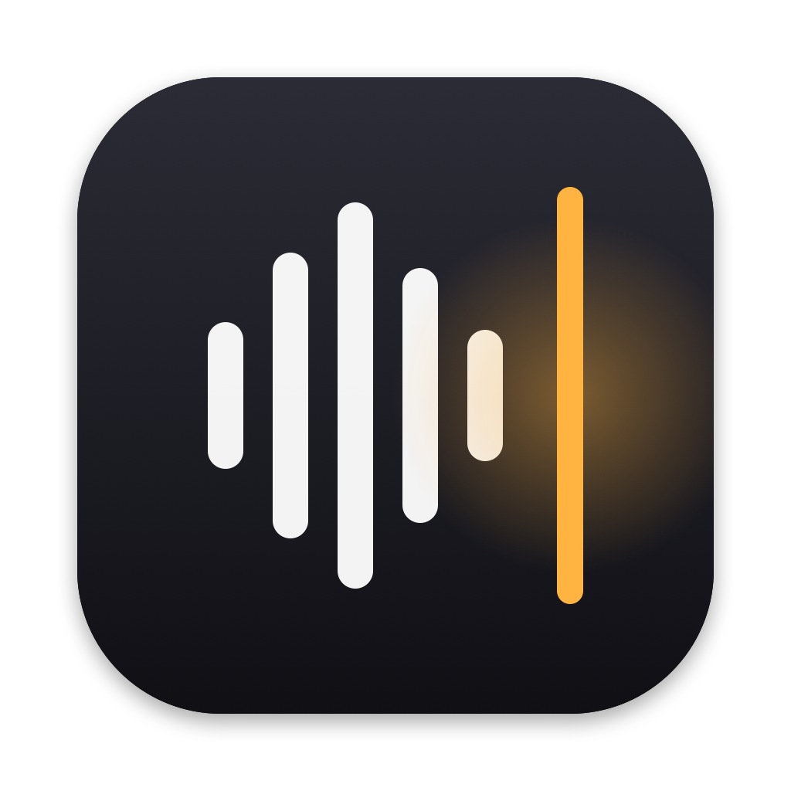
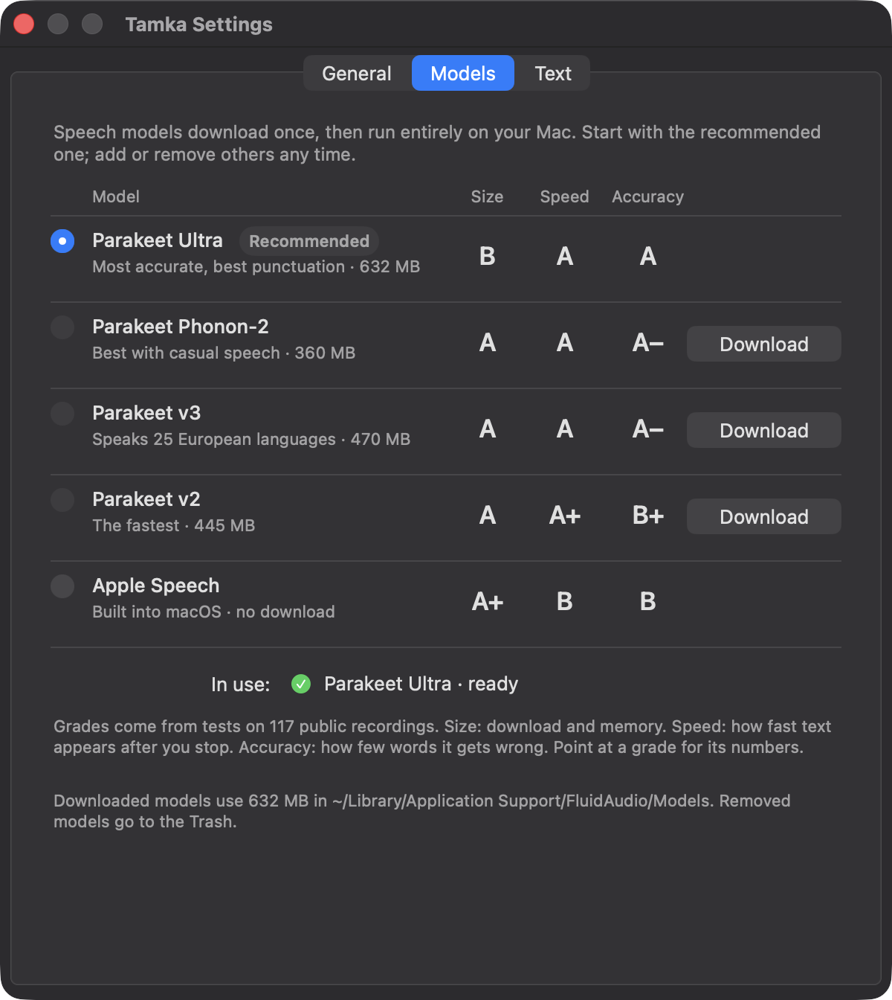
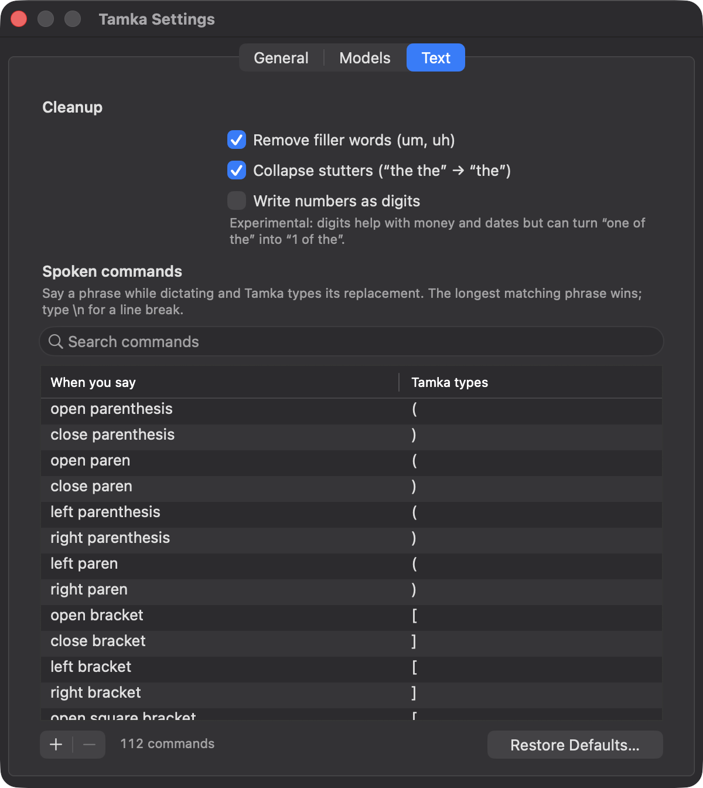

<p align="center">
  
</p>

<h1 align="center">Tamka</h1>

<p align="center">
  <strong>Private, on-device dictation for Apple silicon Macs.</strong><br>
  Press a shortcut, speak, press it again, and clean text appears wherever you're typing.
</p>

<p align="center">
  
  
  
  
</p>

*Tamka* is Swahili for "to pronounce, to utter."

---

## Why Tamka

- **Private.** Speech recognition runs on your Mac's Neural Engine. What you say never leaves your Mac.
- **Light.** The app takes about 15 MB of memory and its speech engine about 50 MB, plus the model you choose. Nothing runs while you're not dictating.
- **Fast.** Text appears about 0.2 seconds after you finish a 50-second dictation.
- **Clean text.** "Um" and "uh" disappear, stutters collapse ("the the" → "the"), and spoken commands like "open paren" or "new line" become symbols.
- **Your choice of model.** The app ships without one. Download the model you want, with plain letter grades to help you pick.

<p align="center">
  
</p>

## How it works

1. Press **⌥V** (or your own shortcut) in any app.
2. Speak. A small pill at the bottom of the screen shows that Tamka is listening.
3. Press **⌥V** again. Tamka types the text where your cursor is and leaves a copy on the clipboard.

Press **Esc** while listening to discard the recording.

<p align="center">
  
</p>

The menu bar icon shows your last five dictations; click one to copy it again. **Transcribe Last Recording Again** re-runs the most recent recording, for example after you switch models.

## Choose a model

Models download once, then work offline. Pick one in **Settings › Models**. You can download, switch and remove models at any time; removed models go to the Trash.

| Model | Size | Speed | Accuracy | Best for |
|---|:-:|:-:|:-:|---|
| **Parakeet Ultra** (recommended) | B | A | A | Everyday dictation: the most accurate, with the best punctuation |
| Parakeet Phonon-2 | A | A | A− | Casual, spontaneous speech |
| Parakeet v3 | A | A | A− | Dictating in 25 European languages |
| Parakeet v2 | A | A+ | B+ | The fastest, for quick notes |
| Apple Speech | A+ | B | B | Nothing to download; built into macOS |

- **Size** combines the download and the memory while the model is ready (Ultra: 630 MB).
- **Speed** is how quickly text appears after you stop talking.
- **Accuracy** is how few words it gets wrong on everyday speech.
- Point at any grade in the app to see its numbers.

The grades come from [Tamka's benchmark](docs/benchmark-public.md): 117 public recordings with human-checked transcripts, covering read speech, meetings and earnings calls.

## Spoken commands

Say a phrase while dictating and Tamka types its replacement. 112 commands come built in, and you can edit them in **Settings › Text**.

| Say | Get | Say | Get |
|---|---|---|---|
| "open paren" … "close paren" | ( … ) | "new line" | a line break |
| "open quote" … "close quote" | " … " | "new paragraph" | a blank line |
| "comma" | , | "question mark" | ? |
| "at sign" | @ | "percent sign" | % |
| "em dash" | — | "smiley face" | :) |

Spacing is handled for you: "call foo open paren bar close paren" becomes `call foo (bar)`.

<p align="center">
  
</p>

## Install

Tamka builds from source. You need:
- an Apple silicon Mac with macOS 26 or later;
- Xcode 26 or later;
- Rust 1.88 or later.

```bash
git clone https://github.com/piedol/tamka.git
cd tamka
scripts/bundle.sh --install
```

This builds the app and its speech engine, signs them, copies `Tamka.app` to Applications and opens it. Signing uses a Developer ID certificate when one is installed, and falls back to an ad-hoc signature otherwise; set `TAMKA_SIGN_IDENTITY` to choose a different one.

On first launch:

1. **Settings › Models opens.** Download **Parakeet Ultra**; it takes a minute or two, once.
2. **Allow Accessibility** when macOS asks. Tamka needs it to press ⌘V for you; without it, text is copied and you paste it yourself.
3. **Allow the microphone** the first time you dictate.

Tamka is a menu-bar app; it has no Dock icon. Turn on **Launch Tamka at login** in Settings › General.

## Settings

| Tab | What's there |
|---|---|
| **General** | Your shortcut (click it, then press new keys), the recording time limit, paste and clipboard behaviour, sounds, launch at login, live permission status, the activity log |
| **Models** | Download, switch and remove speech models, with grades and live status |
| **Text** | Filler and stutter cleanup, numbers as digits (experimental), and your spoken commands in a searchable, editable table with undo |

Every change applies immediately; there's nothing to save. Settings live in `~/Library/Application Support/Tamka/settings.json`.

## Privacy

- **Network:** Tamka only connects to the internet when you download a model. Parakeet models come from Hugging Face; Apple Speech comes from Apple.
- **Recordings:** the microphone is on only between your two shortcut presses. The most recent recording is kept in `~/Library/Caches/Tamka/last.wav`, so it can be transcribed again; each dictation replaces it.
- **Logs:** `~/Library/Logs/Tamka.log` records events and timings, never what you said.
- **History:** recent transcripts live in memory only and are gone when you quit.

## Benchmarks

On 117 public clips (32 minutes), Tamka's recommended model compared with a Whisper large-v3-turbo baseline:

| | Whisper large-v3-turbo | Parakeet Ultra in Tamka |
|---|---|---|
| Word errors, all clips | 9.9% | **7.7%** |
| Word errors, everyday speech | 6.9% | **6.2%** |
| Memory | 1.2–1.6 GB | **~0.5 GB** |
| Text after a 50-second dictation | 471 ms | **170 ms** |

The full method, all 13 configurations tested, and the trade-offs are in [docs/benchmark-public.md](docs/benchmark-public.md). To benchmark models on your own voice, see [eval/README.md](eval/README.md).

## Under the hood

```text
Tamka.app
├── Contents/MacOS/Tamka               Rust (objc2): menu bar, shortcut, microphone, cleanup, paste, Settings
└── Contents/Helpers/tamka-engine      Swift: FluidAudio running Parakeet on the Neural Engine
```

The speech engine runs as a separate helper process that keeps the model loaded. If it ever stops, Tamka restarts it on the next dictation. The two talk over stdin/stdout in JSON lines.

| Path | Role |
|---|---|
| `src/app.rs` | Menu bar and the dictation flow: idle → listening → transcribing → paste |
| `src/audio.rs` | Microphone capture with AVAudioEngine, only while listening |
| `src/engine.rs` | Starts and supervises the speech helper |
| `src/models.rs` | Model catalog with grades; download, remove and status through the helper |
| `src/text.rs` | Filler removal, stutter collapse, spoken commands and spacing (unit-tested) |
| `src/paste.rs` | Clipboard, then ⌘V via CGEvent once your modifier keys are released |
| `src/settings_window.rs` | The Settings window |
| `src/hud.rs` | The listening pill and notifications; they never take focus from your app |
| `engine/` | The Swift speech helper |
| `eval/` | The benchmark harness |
| `scripts/` | Build, sign and icon scripts |

## Development

```bash
cargo test --release                            # unit tests
scripts/bundle.sh                               # build and sign dist/Tamka.app
target/release/Tamka --transcribe clip.wav      # engine + cleanup on a file, no microphone needed
open "tamka://settings-models"                  # open Settings on a tab: settings, settings-models, settings-text
open "tamka://hud-demo"                         # show the listening pill's states
```

## Credits

- **Speech runtime:** [FluidAudio](https://github.com/FluidInference/FluidAudio) (Apache-2.0).
- **Models:**
  - [NVIDIA Parakeet](https://huggingface.co/nvidia/parakeet-tdt-0.6b-v2) (CC-BY-4.0).
  - Parakeet Ultra by [Moondream](https://huggingface.co/moondream/parakeet-ultra).
  - Phonon-2 by Fermion Research.
  - Each model's license is set by its authors; see its page before redistributing it.
- **Benchmark data:**
  - [LibriSpeech](https://www.openslr.org/12) (CC-BY-4.0).
  - [FLEURS](https://huggingface.co/datasets/google/fleurs) (CC-BY-4.0).
  - [AMI](https://groups.inf.ed.ac.uk/ami/corpus/) (CC-BY-4.0).
  - [Earnings-22](https://huggingface.co/datasets/distil-whisper/earnings22) (CC-BY-SA-4.0).

## License

[PolyForm Noncommercial 1.0.0](LICENSE.md). © 2026 piedol.
